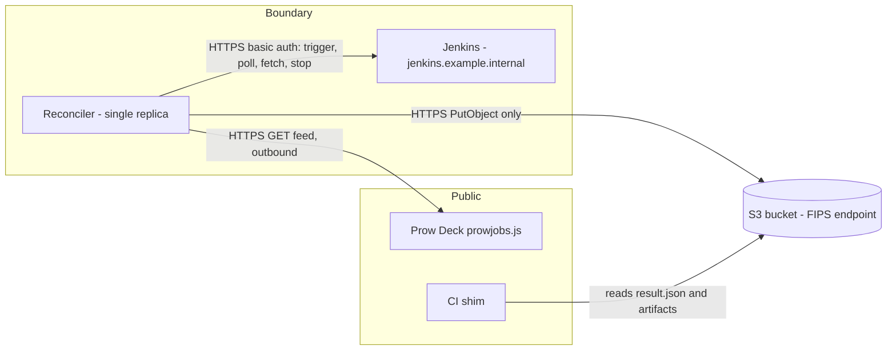
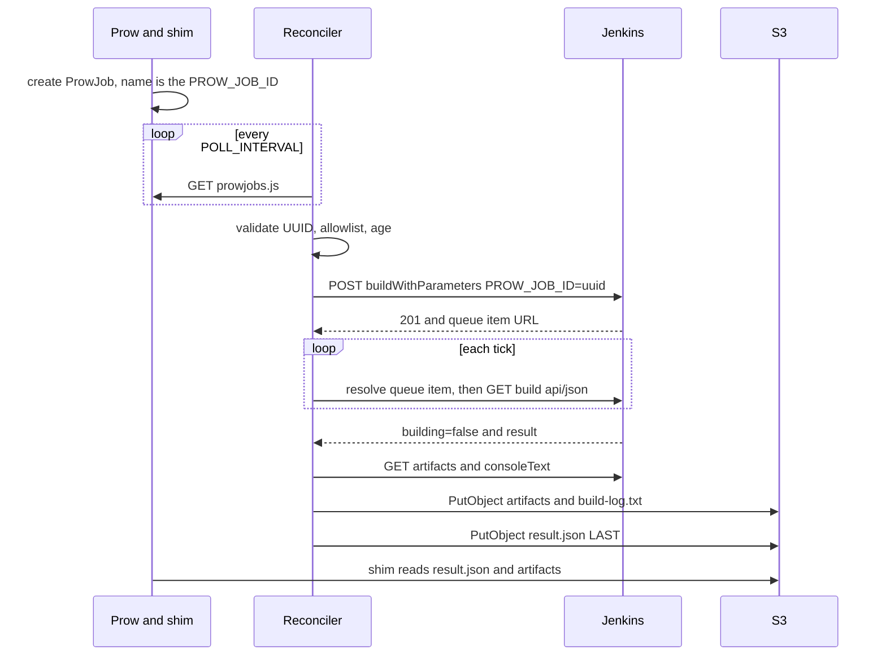
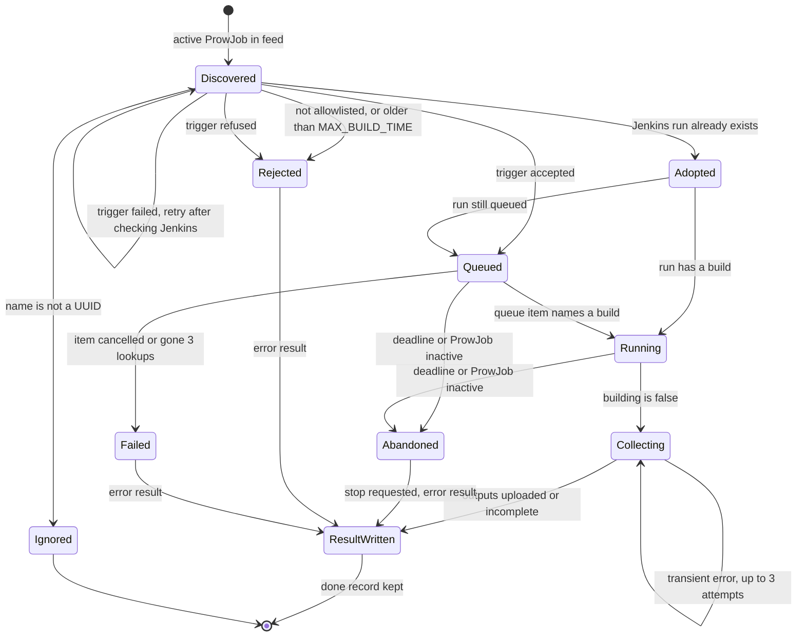

# How the reconciler works

## What it is and why

Prow runs in public; Jenkins runs inside the compliance boundary. The two never talk
directly. The reconciler runs **in-boundary**, polls the public Prow feed (outbound
only), triggers the matching Jenkins job, and copies the build's results to S3. A
**CI shim** on the Prow side polls S3 and turns `result.json` into the ProwJob's
outcome. Nothing connects into the boundary, and the reconciler never writes to Prow.

For settings, IAM and build/run instructions see [README.md](../README.md).

## Architecture



State is in memory. Jenkins is the record used to rebuild it after a restart.

## End-to-end flow



## Job lifecycle



State names are descriptive; the code only has queued and running phases.

- **Discovered**: active means ProwJob state `triggered` or `pending`, with the executor
  label and a `govcloud.ci/jenkins-job` annotation.
- **Done record**: after any terminal outcome the job is remembered and never triggered
  or written again while Prow still lists it. Pruned when the feed shows it non-active,
  or after `MAX_BUILD_TIME` of absence.
- **Deadline**: `MAX_BUILD_TIME` after the earlier of trigger time and ProwJob start.
  Checked after the Jenkins poll, so a build that already finished reports its real result.
- **Abandoned**: also when the ProwJob left the feed for `FEED_ABSENT_POLLS` consecutive
  successful, non-empty polls. An empty poll is no evidence and resets the streak; a failed poll is skipped.
  The run is stopped in Jenkins (one attempt at once, then on later ticks, 10 in all, each
  re-reading the run);
  the error result does not wait for the stop.

## Trigger and retry rules

Trigger is `POST {JENKINS_URL}/job/<job>/buildWithParameters` with basic auth; only
`PROW_JOB_ID` is sent, in the form body. Success is `201` with a `Location` header.

| Outcome of trigger | Treatment |
|---|---|
| `201` + Location | Tracked as queued |
| 4xx except 401, 403, 408, 429 | Terminal. Error result "Jenkins rejected the trigger with HTTP N"; no retry |
| 401 or 403 | Retried next tick; the 3rd consecutive one gives an error result. Any other failure resets the count |
| 5xx, 408, 429, network error, timeout, 201 without Location | Marked uncertain. Next tick Jenkins is searched for a run with this `PROW_JOB_ID`: found, adopt it; not found, trigger again; Jenkins unreadable, do not trigger. So no duplicate builds |
| Jenkins request timeout | Rest of the pass is skipped until the next tick |

| Recovery case | Behaviour |
|---|---|
| Restart | Before the first trigger, the queue and last 100 builds of each allowlisted job are read; matching active ProwJobs are adopted. If Jenkins is unreadable, retry with backoff (capped at 5 min) and trigger nothing |
| Queue item cancelled | Error result |
| Queue item 404 | Jenkins expires items. Look the run up by `PROW_JOB_ID`: build found, follow it; still queued, follow the new URL; nothing found, count a miss. 3 consecutive misses give an error result. A failed lookup is not a miss |
| Build beyond the last 100 | Not found by recovery; an active ProwJob would be triggered again |

## S3 layout and result.json

```
s3://<S3_BUCKET>/
  {PROW_JOB_ID}/
    artifacts/
      build-log.txt          console log, tail only
      reports/junit_01.xml   archived Jenkins artifacts, relative paths kept
    result.json              written LAST; the shim's completion signal
```

`result.json` fields (all but `status` are omitted when empty):

| Field | Meaning |
|---|---|
| `status` | `success`, `failure` or `error` |
| `duration` | Jenkins build duration as a Go duration, e.g. `3m12s`. Set only when Jenkins reports a duration (above 0) |
| `jenkins_build` | Jenkins build URL, if a build started |
| `artifacts` | Names actually uploaded, relative to `artifacts/`, including `build-log.txt` |
| `message` | Human-readable detail; untrusted strings are truncated |

Status comes from the Jenkins result only if every output reached S3:

| Jenkins result | status |
|---|---|
| `SUCCESS` | `success` |
| `FAILURE`, `UNSTABLE` | `failure` |
| `ABORTED`, `NOT_BUILT`, empty, anything else | `error` |
| any, but an output is missing | `error`, message lists what is missing |

`aborted` is never produced. Reconciler-side errors are `error` with a message and no
`duration`: rejection (allowlist, age), trigger refused, queue item cancelled or gone, and
timeout (`timed out: no Jenkins result within MAX_BUILD_TIME (2h0m0s); stopping the Jenkins run`).
A ProwJob that is no longer active gets e.g. `ProwJob is aborted in Prow; stopping the Jenkins run`.

Artifact rules:

- Jenkins' relative path is kept. Skipped, with no retry and an `error` result, if it has
  empty, `.` or `..` segments (so absolute paths too), backslashes, control characters or
  invalid UTF-8, if the key would exceed 1024 bytes, or if it is `build-log.txt`.
- Caps: `MAX_ARTIFACTS` per build (extras skipped), `MAX_ARTIFACT_BYTES` each,
  `MAX_TOTAL_ARTIFACT_BYTES` combined. Oversized files are skipped without being buffered.
- `build-log.txt` keeps the last `MAX_LOG_BYTES` behind a truncation notice. This is noted
  in `message` and does not change `status`.
- Order: archived artifacts, then the log, then `result.json`. Retries skip objects already
  uploaded.

## Failure handling

| Situation | Behaviour |
|---|---|
| Feed poll fails, truncated or oversized | Poll skipped; nothing triggered, nothing inferred as gone |
| S3 down while collecting | After the first upload error the rest are not attempted. The job stays in flight and collection is retried on later ticks, 3 attempts in all, then an `error` result is attempted |
| S3 down for `result.json` | Result is held in memory; only `PutResult` is retried each tick. Gives up (logged, nothing written) once the ProwJob is inactive or, for a build that finished on its own, the deadline passes. A timed-out run's error result is retried until the ProwJob is inactive (or another `MAX_BUILD_TIME` passes), since it is the only answer the shim gets. Applies to every job the reconciler has triggered or adopted. Rejections before a trigger (allowlist, age) are re-evaluated and rewritten on the next poll instead |
| Jenkins request times out (30 s API, 15 min downloads) | Current pass stops; remaining jobs wait for the next tick |
| Tick overruns `POLL_INTERVAL` | Ticker is reset so the next poll waits a full interval |
| `MAX_BUILD_TIME` exceeded (default 2h) | Run stopped in Jenkins, log so far uploaded, `error` result with a "timed out" message |
| ProwJob finished or missing in feed | Same as timeout, message names the reason |
| Stop not confirmed | Registered once; retried on later ticks, 10 attempts in all, then logged and dropped. Not kept across restarts, but recovery stops any recovered run whose ProwJob has finished |
| SIGTERM or SIGINT | No new poll, trigger or job starts. Step in progress finishes on a detached context for up to `SHUTDOWN_TIMEOUT` (default 30s). Exit 0, or 1 if cut off. Builds are not stopped; restart recovery adopts them. A cut-off never writes `result.json` for partial outputs |
| Two replicas | Unsupported: no leader election, both would trigger. Run exactly one |

The loop is a single goroutine, so a slow feed or a large collection delays other jobs.

## Security and operations

- Jenkins: basic auth (`JENKINS_USER` plus API token) on every call. `JENKINS_JOB_TOKEN`
  is rejected at startup. Credentials go only to the `JENKINS_URL` origin; off-origin
  redirects are refused and returned URLs are rebased or rejected.
- Only `PROW_JOB_ID` is sent to Jenkins. Each allowlisted job must declare it as a string
  parameter, since recovery depends on it. No other ProwJob field becomes a parameter.
- The feed is untrusted: names must be canonical UUIDs, jobs must be allowlisted, and feed
  strings are truncated before they reach logs or `result.json`.
- S3: `s3:PutObject` only, on `arn:aws-us-gov:s3:::<S3_BUCKET>/*`. No read, list or delete.
  A customer-managed SSE-KMS key also needs `kms:GenerateDataKey`.
- S3 always uses FIPS endpoints unless `S3_ENDPOINT` is set, which replaces the endpoint.
- No secrets are logged; URLs are scrubbed of query and userinfo; S3 errors log only
  bucket, key, error code, status and request ID.
- `jenkins_build` in `result.json` is the Jenkins build URL, readable by anyone who can read
  the bucket. Archived files and the console log leave the boundary, so archive only
  non-protected CI output.
- Timing: `MAX_BUILD_TIME` (default 2h) is not checked against the CI shim's wait. If the
  shim waits no longer than that, it may give up before the reconciler's "timed out" result
  lands. Keep the shim's wait above `MAX_BUILD_TIME` to see that result.
